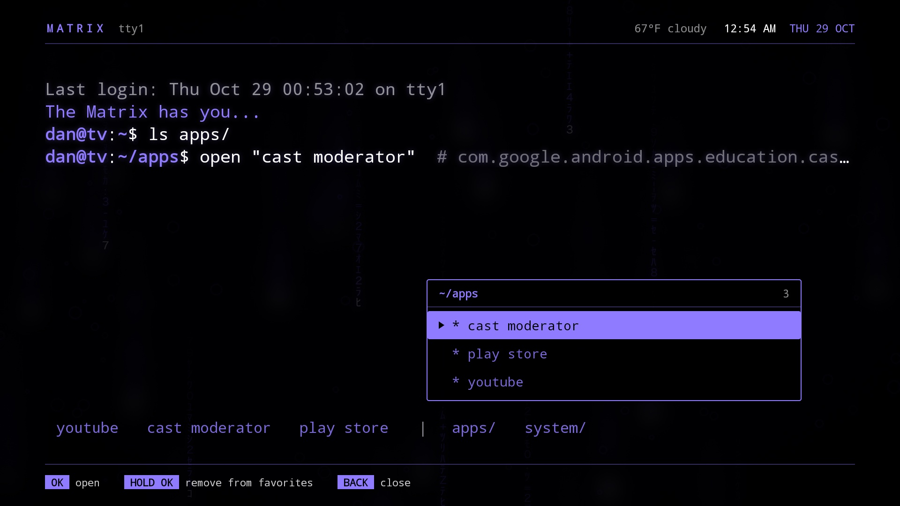
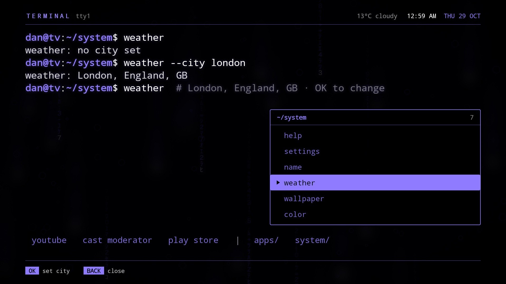

# Terminal

A home screen (launcher) for Android TV and Google TV, styled as a clean retro computer terminal:
monospace text on black, a typed prompt, inverse-video selection, digital rain, and no
app icons anywhere. Seven colours re-light the whole screen. Kotlin, no dependencies, views built
in code.



## Try it

You need Android Studio (for the SDK and its bundled JDK) and an Android TV device or emulator
running Android 10 (API 29) or later.

**On an emulator.** Create an Android TV (1080p) virtual device named `Terminal_TV`, then:

```bash
./run.sh
```

It boots that emulator if needed, builds, installs, and makes Terminal the Home app. Use
`AVD=<name> ./run.sh` for a device with another name. Your keyboard is the remote (arrows, Enter
for OK, Esc for Back) only if the AVD's `config.ini` has `hw.keyboard=yes`; Android Studio
creates TV devices with `no`.

**On a TV.** Turn on developer options and ADB/network debugging on the TV, then:

```bash
./install-tv.sh 192.168.1.20
```

It installs a release build and opens it, but leaves your TV's Home app as it was. To make
Terminal your home screen, pick it when the TV asks which home app to use, or run
`adb shell cmd package set-home-activity io.github.mattdillioncodes.terminal/com.matthew.matrixhome.HomeActivity`. Pressing Home
then opens Terminal.

## Using it

```
TERMINAL  tty1                                67°F cloudy   9:44 PM  WED 28 OCT
────────────────────────────────────────────────────────────────────────────────
Last login: Wed Oct 28 22:03:12 on tty1
Welcome back, friend.
guest@tv:~/apps$ open "play store"█ # com.android.vending

                                         ┌ ~/apps ─────────────── 3 ┐
                                         │   netflix                 │
                                         │ ▶ * play store            │
                                         │ * youtube                 │
                                         └───────────────────────────┘
 youtube   play store   |   apps/   system/
────────────────────────────────────────────────────────────────────────────────
 OK  open    HOLD OK  remove from favorites    BACK  close
```

- **The bottom line** holds up to five favourites, then two folders. `apps/` lists every TV app,
  with `*` marking favourites. `system/` holds help, settings, your name, weather, wallpaper,
  colour and ambient.
- **Moving** types that entry's command at the prompt, the way a person would: it backspaces to
  what the two commands share, then types the rest. **OK** runs the command. **Hold OK** adds or
  removes a favourite. **Back** closes a menu.
- **The key bar** along the bottom always says what the buttons do right now.
- **Help** (`man terminal`) opens by itself on first launch, and from `system/ > help` after that.
- **Name** (`system/ > name`) sets the prompt's user and the greeting. For example, typing
  `Ada` makes the prompt `ada@tv` and the greeting "Welcome back, Ada."
- **Weather** (`system/ > weather`): type a city name. It's looked up with
  [Open-Meteo](https://open-meteo.com) (free, no API key) and shown in the status line in words:
  `18°C rain`. Places in the US and a few other countries show °F. Until you set a city, no
  weather appears and nothing is sent anywhere.
- **Wallpaper and colour**: six scenes in each of seven colours. The scene changes every visit
  to Home and every 60 s. While the cursor is on `wallpaper` the dimming lifts so you can see it.
- **Ambient**: after 3 minutes idle on Home, full-screen rain with a big clock. Any button
  brings Home back, and volume and media keys keep working.



## How the rain works

Done the way the films do it (after Rezmason's frame-by-frame study of the originals). The
glyphs sit still in a fixed grid, and what falls is light. Each column has two raindrops, a
near-white tracer with a fading tail, sweeping through stationary symbols while random cells
change glyph. The glyph set follows Simon Whiteley's recipe: mirrored half-width katakana,
numerals and a few symbols.

- Glyphs are pre-rendered once into `ALPHA_8` atlases. An alpha-only bitmap draws in the paint's
  colour, so changing the colour just changes `paint.color`, with no re-rendering.
- It steps at about 30 fps, since the film's rain moves cell by cell anyway. At intensity 0 it
  stops drawing, so Home redraws only for the cursor blink.
- Text glows stay at 10dp (20px) or less. Above Android's 25px blur limit, a text shadow renders
  as a dark box.
- Katakana come from the system's Noto CJK font. If a TV doesn't have it, the rain uses numerals
  and symbols only.

## Code

| File | What it is |
| --- | --- |
| `HomeActivity.kt` | The screen: status line, terminal, the line, menus, editors, ambient |
| `Terminal.kt` | The shell session: prompt, scrollback, human-style typing and erasing |
| `Menu.kt`, `Term.kt` | Pop-up menu window and the inverse-video entries |
| `Rain.kt`, `Glyphs.kt` | Digital rain and its glyph atlases |
| `Hues.kt` | The seven colours and the wallpaper scenes |
| `Weather.kt` | Open-Meteo forecast and city lookup |
| `Help.kt` | The `man terminal` help page |

The wallpapers (`app/src/main/assets/wallpapers/<colour>/<scene>.webp`, 1920x1080 sRGB, WebP quality 88) decode
straight into GPU bitmaps. Swap in your own by keeping those names.

Release builds are signed with your local debug key, so they install with no setup. Use your own
signing key before giving the APK to anyone.

## License

MIT, see [LICENSE](LICENSE). The wallpapers are by the author and covered by the same license.

An original project by Matt Dillion Shoots. Inspired by classic computer terminals.
